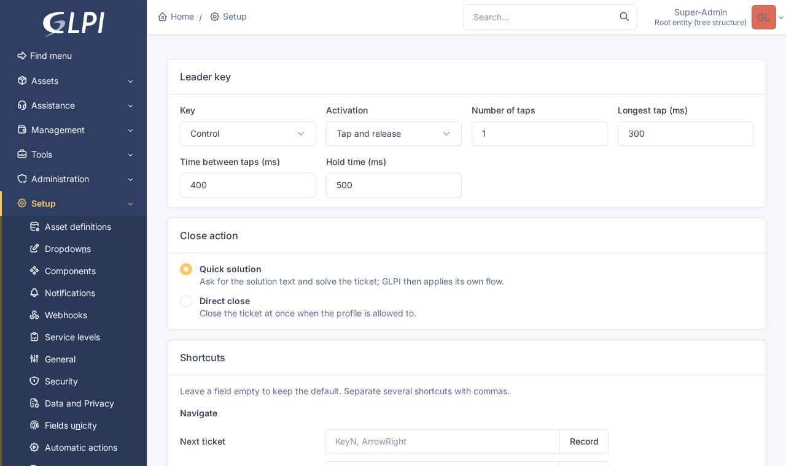

# Configuration

In **Setup > Plugins** open the **Configure** icon of TicketBoost (or go to
`/plugins/ticketboost/front/config.form.php`). An administrator with the _configure_ right
sets the defaults for the whole installation:

| Setting      | Default                                     | Description                                                                                                                                                                      |
| ------------ | ------------------------------------------- | -------------------------------------------------------------------------------------------------------------------------------------------------------------------------------- |
| Leader key   | Ctrl                                        | Key that opens the panel                                                                                                                                                         |
| Taps         | 1                                           | Taps needed to open the panel (1 to 3)                                                                                                                                           |
| Tap length   | 300 ms                                      | Longest press that still counts as a tap                                                                                                                                         |
| Tap window   | 400 ms                                      | Maximum time between taps                                                                                                                                                        |
| Mode         | Tap                                         | Tap and release, or hold for a given time                                                                                                                                        |
| Hold time    | 500 ms                                      | How long the key must be held in hold mode                                                                                                                                       |
| Key bindings | See [Shortcuts](../user-guide/shortcuts.md) | Default key of every action                                                                                                                                                      |
| Close mode   | Quick solution                              | `Quick solution`: asks for a solution text and follows the normal GLPI solve and approval flow. `Direct close`: sets the status to Closed when the profile allows it |

Users can override the keyboard settings for themselves unless the plugin is disabled
for their profile.

## Changing a shortcut

Each action has a field that shows its default as a placeholder. Leave it empty to keep
the default, or type one or more shortcuts separated by commas, for example
`Ctrl+Shift+KeyK, KeyJ`. The **Record** button fills the field with the next key you press
(press _Esc_ to cancel).

The page checks the shortcuts as you type and points out any that is not valid, is kept
by the browser or GLPI (such as `Ctrl+W`), or is already used by another action. The
server checks them again when you save: if any shortcut cannot be used, nothing is saved
and the page shows what to change.

Changes apply the next time a page is loaded.
