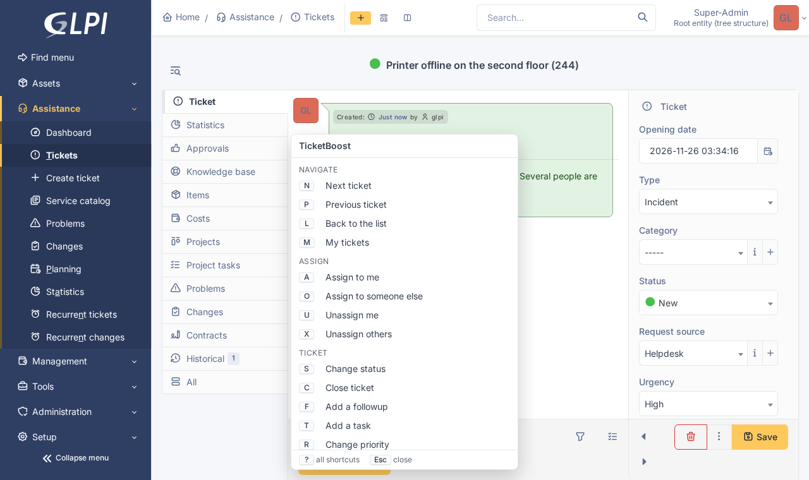

# First steps

1. Open any ticket.
2. Tap and release ++ctrl++. The shortcut panel appears at the bottom of the screen.
3. Press ++a++ to assign the ticket to yourself, or ++n++ to open the next ticket of
   your last list.
4. Press ++question++ in the panel to see every shortcut, and ++esc++ to close it.

See [Shortcuts](../user-guide/shortcuts.md) for the full list.
