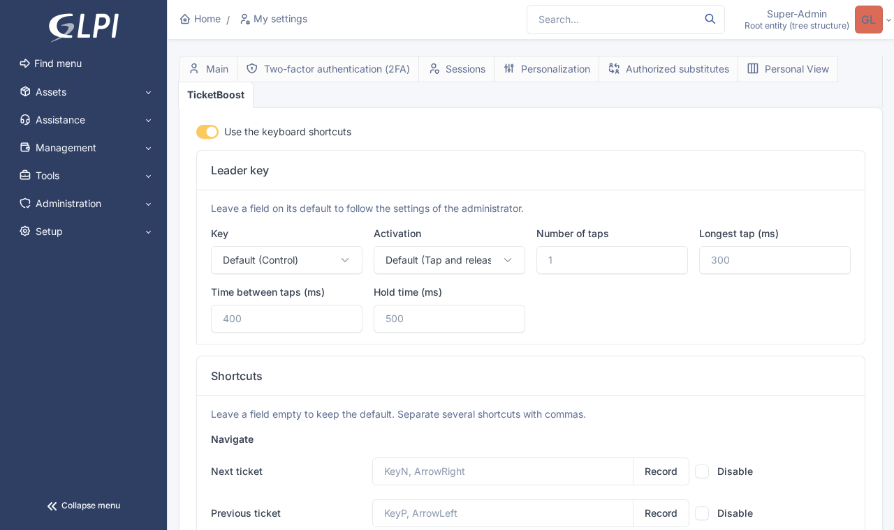

# Personal settings

In **My settings > TicketBoost** each user whose profile can use the plugin can:

- turn the keyboard shortcuts off for themselves
- change the leader key, the activation mode, the number of taps and the timing
- change the shortcut of any action, or disable the action
- restore the defaults set by the administrator

A field left on its default follows the administrator: if the defaults change later, you
get the new value. Only what you fill in is stored as your own.

## Changing a shortcut

Each field shows the current default as a placeholder. Leave it empty to keep it, or type
one or more shortcuts separated by commas, for example `Ctrl+Shift+KeyK, KeyJ`. The
**Record** button fills the field with the next key you press (press _Esc_ to cancel).
Tick **Disable** to remove the action from your panel; its shortcut then becomes free for
another action.

The page flags a shortcut that is not valid, is kept by the browser or GLPI, or is already
used by another action, and nothing is saved until it is solved. Changes apply the next
time a page is loaded.

If the administrator later takes a key that you use, your own shortcuts are not applied
until you change them, and the tab tells you which ones clash.

## Settings of another user

An administrator who can configure TicketBoost and can update a user also finds the
**TicketBoost** tab on that user's form (**Administration > Users**), unless that user has
more rights than the administrator.
